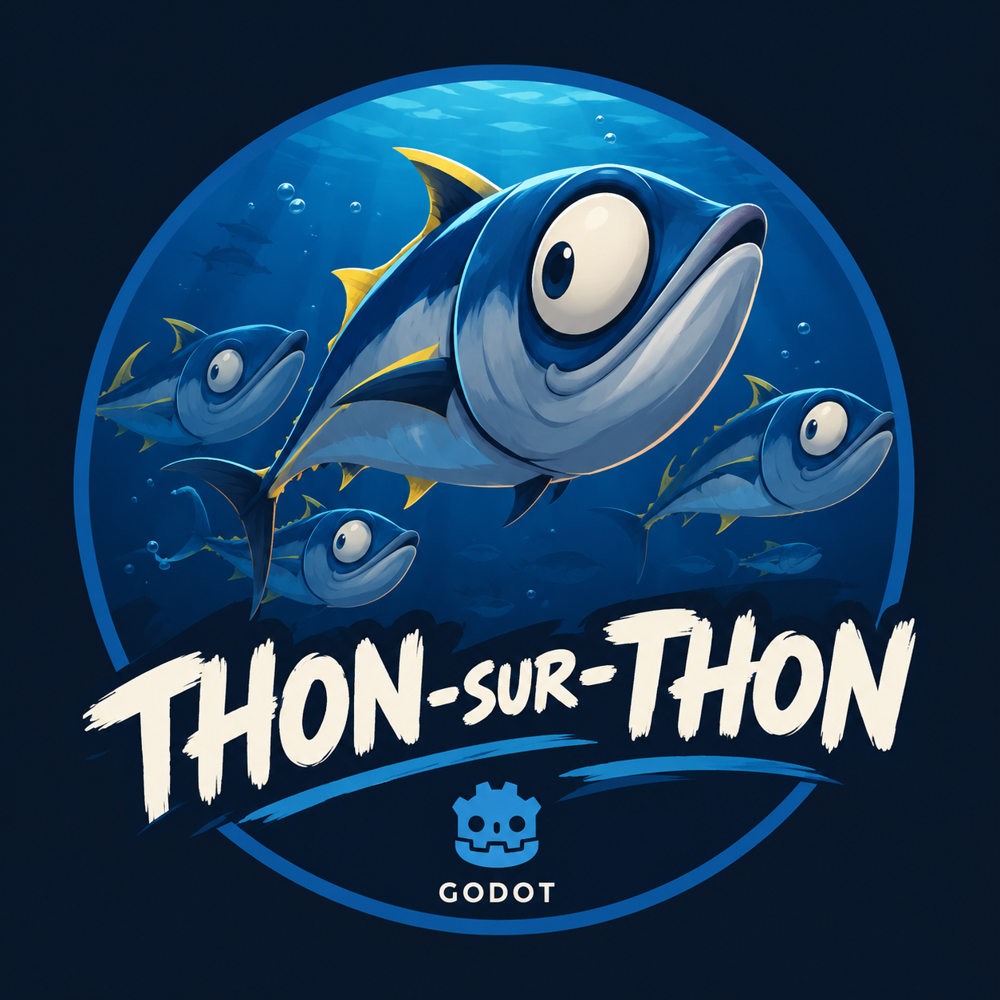
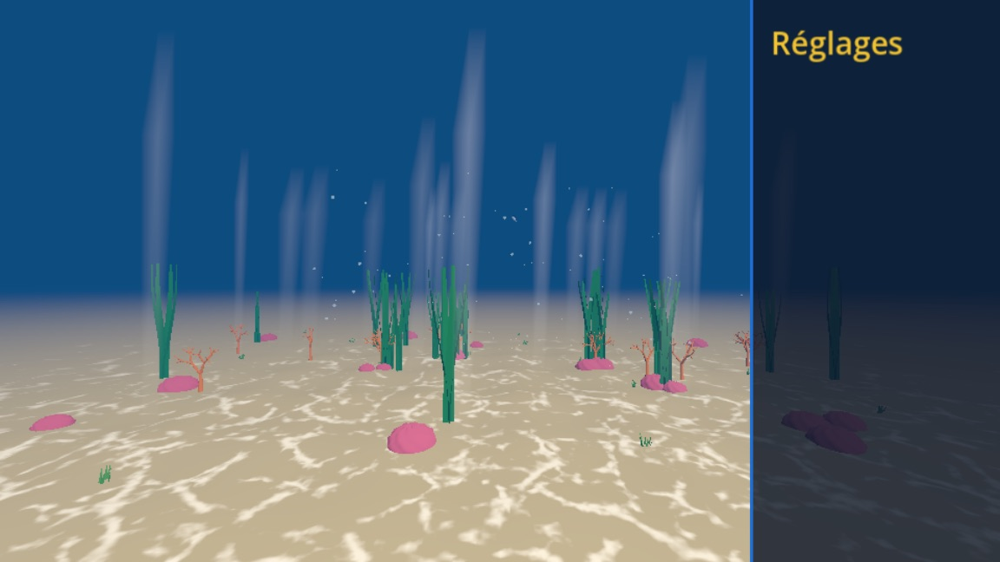

# Thon sur thon



Projet SMA – M2 ILIADE (Lou et Simon) : un banc de thons en 3D (Godot) qui contourne un rocher, fuit un requin, se disperse puis se reforme.
Objectif : montrer le phénomène d'émergence. Chaque thon ne voit que ses voisins ; le banc n'a pas de chef.



## Pour commencer

| Quoi | Où |
| --- | --- |
| Le trailer (1 min 14) | [soutenance/trailer.mp4](soutenance/trailer.mp4) |
| Le diaporama de soutenance | [PDF](soutenance/thon-sur-thon.pdf) (lisible sur GitHub), [PowerPoint](soutenance/thon-sur-thon.pptx), [HTML](soutenance/thon-sur-thon.html) (à télécharger puis ouvrir dans un navigateur) |
| Les schémas de la soutenance | [soutenance/schemas/](soutenance/schemas/) |
| L'application | [godot/](godot/), voir [Lancer l'application](#lancer-lapplication) |
| La documentation | [doc/](doc/), voir [Où trouver quoi](#où-trouver-quoi) et [Voir la doc](#voir-la-doc) |

## Où trouver quoi

| Fichier | Contenu |
| --- | --- |
| [doc/idee-generale.md](doc/idee-generale.md) | Le projet en bref |
| [doc/la-simulation.md](doc/la-simulation.md) | Vue d'ensemble, pas de simulation, émergence |
| [doc/le-thon.md](doc/le-thon.md) | Vision, nage et forces du thon |
| [doc/le-requin.md](doc/le-requin.md) | États et poursuite du requin |
| [doc/versions.md](doc/versions.md) | Contenu et critères de fin de chaque version |
| [doc/feuille-de-route.md](doc/feuille-de-route.md) | Étapes et tâches à cocher |
| [doc/interface.md](doc/interface.md) | Charte d'interface et d'ergonomie (commande `/ui`) |
| [doc/ecran-de-demarrage.md](doc/ecran-de-demarrage.md) | Décor, écran d'accueil et plongée : décisions, avancement, captures |
| [doc/trailer.md](doc/trailer.md) | Tournage, son et montage du trailer |
| [PRATIQUES-GIT.md](PRATIQUES-GIT.md) | Branches, versions, commits |

Le code est dans `godot/` : `thon/` (comportement et apparence du thon), `obstacles/` (rocher et requin), `aquarium/`, `decor/`, `accueil/`, `interface/`, et `mesures/` (scripts de mesure sans fenêtre).

## Lancer l'application

Ouvrir `godot/` dans Godot 4.7, puis `F5`. L'application s'ouvre sur l'accueil :

- **Plonger** (ou `Entrée`) : la caméra plonge jusqu'à l'aquarium ; un clic passe la plongée.
- Dans l'aquarium : clic gauche + glisser pour tourner, molette pour zoomer, `Z Q S D` (`W A S D` en QWERTY) pour se déplacer, `Espace` et `Maj` pour monter et descendre, `Origine` pour recentrer, `Tab` pour le panneau de réglage, `R` pour relancer la simulation.
- `Échap` : remonter à l'accueil. **Quitter** ferme l'application.

Chaque scène se lance aussi seule avec `F6` : `aquarium/aquarium.tscn`, `accueil/accueil.tscn`.

## Mesurer sans fenêtre

Les poids des forces ont été choisis sur des mesures. Pour en refaire une (5 minutes simulées, depuis la racine du dépôt, `godot` étant le binaire de Godot 4.7) :

```bash
godot --headless --path godot/ --fixed-fps 60 -s mesures/mesure_banc.gd -- graine=1 n=18000
```

Les arguments sont décrits en tête de [godot/mesures/mesure_banc.gd](godot/mesures/mesure_banc.gd).

## Voir la doc

```bash
cd doc
npm install
npm run dev
```
